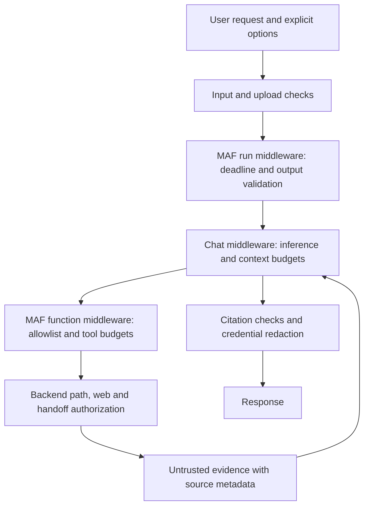

# Phase 3: guardrails and poisoning prevention

Phase 3 adds backend enforcement around the existing single MAF agent. No new model, package, paid AI service or model download is required. The defaults remain local `qwen3:8b` chat/reranking and `nomic-embed-text` embeddings.

## How enforcement works



`GuardrailAgentRunner` is the shared execution path for ordinary questions, project analysis and attachment chat. It wraps the existing agent with native MAF run and function middleware using `AsBuilder().Use(...).Build()`. `GuardrailChatClient` adds model-call and output-token limits. These use the installed SDK's supported [middleware interfaces](https://learn.microsoft.com/agent-framework/agents/middleware/).

Trusted permissions live in a per-run `GuardrailRunState`. Tool arguments, uploaded JSON fields, retrieved instructions and model output cannot set these permissions. Function invocations are serialized within a run; arguments are hashed for repetition counting and are not retained in guardrail telemetry. An exhausted budget cancels the run and remains exhausted even if the function invoker catches an exception.

Backend services still validate paths, web queries and handoff permissions when invoked directly. A malicious model cannot create new tools: the allowlist contains only `ListProject`, `ReadFile`, `SearchKnowledge`, `SearchWeb` and `ProposeHandoff`. Folder approval and document-review endpoints are not agent tools.

## Limits and response behavior

Configure `Twin:Guardrails` in `appsettings.json`:

| Setting | Default |
| --- | --- |
| MaxToolCalls | 12 per run |
| MaxRepeatedToolCalls | 3 for the same tool/arguments |
| MaxModelCalls | 8 logical inference calls |
| RunTimeoutSeconds | 180 |
| MaxOutputTokens | 4096 per inference call |
| MaxOutputCharacters | 40000 |

Additional fixed bounds cover user messages, uploads, generated input context (60,000 characters), model conversation context including function results (120,000 characters), and individual tool results (32,000 characters). Oversized tool results are explicitly truncated. Run deadlines cover agent execution; extraction/ingestion retain their separate size and provider limits. Hosted fallback, when explicitly configured, may attempt a second provider for a logical inference call.

HTTP responses use 400 for invalid messages/uploads, 429 for exhausted tool/model budgets, 504 for the agent deadline, and 422 for other guardrail failures. Caller cancellation propagates. Failed, rejected or credential-redacted model context is removed from the cached session so it cannot silently reappear on the next turn.

`useKnowledge=true` requires an actual knowledge search. If the agent does not search, or returns no evidence, backend output explains that it cannot verify an answer. When passages were retrieved, the generated answer must mention at least one retrieved source filename. This is a minimum citation check; it does not prove that every statement follows from the evidence. General questions without knowledge evidence continue normally.

Known credential patterns are rejected in raw chat messages and redacted from project file contents, tool results and final answers. Protected path segments such as `.aws`, `.ssh`, `.git`, `.env*`, secret/credential files and `.user` files are excluded. Existing root containment and reparse-point checks remain in force. Model-generated Markdown images are rendered as text, preventing automatic external image requests; links suppress opener/referrer access and require a user click.

## Public search and handoff permissions

Public web search is available automatically. The earlier checkbox and whole-conversation restriction were removed at the user's request. Public questions can use search before or after document/project questions in the same conversation. Backend checks reject recognizable credentials and local file paths in the outgoing query; they do not attempt to classify all private text. See [the response-quality follow-up](WEB-SEARCH-RESPONSE-FIX.md).

`POST /api/agent/ask` accepts optional `useKnowledge` and `allowHandoffProposal` flags, false by default. The legacy `allowWebSearch` property is accepted but ignored:

```json
{
  "sessionId": "optional-guid",
  "message": "Search the official framework documentation.",
  "useKnowledge": false,
  "allowHandoffProposal": false
}
```

`allowHandoffProposal=true` grants permission to create a pending proposal for human review; it cannot approve or export it. Permission is never inferred from phrases inside prompts. The UI's existing **Request review** action remains the direct way to queue a completed answer. Attachment chat does not grant agent-handoff permission; public search is available normally. Multipart attachments accept `useKnowledge=true` when grounded knowledge retrieval is required.

Responses retain `privateContext` as diagnostic metadata for older clients; it no longer disables search. Context markers currently live in memory alongside the existing in-memory conversation state; durable session persistence belongs to Phase 4. Deleting a server session clears its state.

## Screening, quarantine and human review

`ContentSafetyService` screens extracted content and filenames for selected instruction-override, role-spoofing, permission-bypass, exfiltration and credential patterns. Regexes use the non-backtracking engine and bounded execution. Screening is heuristic: legitimate security documentation can be flagged, and novel attacks or misleading factual content can evade detection. Backend permission enforcement is therefore independent of screening.

New Qdrant payloads carry backend-assigned `reviewStatus`, `riskReasons`, `trustLevel=user-uploaded` and a versioned pipeline identifier. Status fields inside uploaded text are ordinary text. Clean documents receive `not-required`; suspicious documents receive `pending` and stay out of normal retrieval. Review state is separate from active/deprecated lifecycle status. Restoring a pending document does not release it.

The knowledge UI's **Review** action shows flagged reasons and the document's chunks. **Approve this revision for retrieval** releases that exact revision as reference material. The APIs are:

- `GET /api/knowledge/documents/{id}/review` returns metadata and content with recognizable credentials redacted.
- `POST /api/knowledge/documents/{id}/review/approve` accepts `{"revision":"64-character-sha256"}`. A replaced revision returns 409.

Documents containing detected possible credentials cannot be approved. Remove the values from the original and re-upload it. Unchanged re-uploads preserve an existing review decision; a changed revision is screened again. Approval does not reactivate a deprecated document or grant any tool permission. Existing local cross-site protections also apply to the new review action.

Qdrant prefilters both lifecycle and review state before selecting candidates. Legacy points without review metadata remain compatible; detected suspicious legacy passages are additionally filtered before reranking. A suspicious legacy document should be re-uploaded to enter the full review workflow. There is no startup bulk migration. The new pipeline version re-indexes existing documents once on their next upload.

Knowledge uploads store quarantined vectors locally for later review. Suspicious inline chat attachments are rejected with a review explanation instead of being sent to the chat model. Screening occurs after extraction: explicitly authorized external OCR/vision may already have processed a file before its extracted text can be screened. Use searchable local documents when external processing is unsuitable. Explicitly selecting hosted chat still authorizes that configured chat provider; the public-search permission is a separate boundary.

## Demo

1. Restart the backend to load the new code and refresh the Vite frontend. Standalone port-5000 hosting needs the existing frontend publish script.
2. Upload `demo-knowledge/08-adversarial-instructions.txt` to the knowledge library. It should show **Review required** and stay out of search.
3. Open **Review**, inspect the text, and approve that revision. It can now be discussed as untrusted evidence. Embedded requests to grant access, read absolute/outside paths or send private data to web search still cannot authorize those actions.
4. Replace the same filename with changed suspicious content. It returns to review; approving an earlier revision is rejected.
5. Ask a public question, such as today's weather, directly. No checkbox or new conversation is required after using project files. A configured public provider key is needed for a real provider call; credential/path rejection tests need none.

## Verification

From the repository root:

```powershell
dotnet test tests/DigitalTwin.Api.Tests --artifacts-path data/guardrail-verification -p:UseAppHost=false
npm.cmd --prefix frontend run build
npm.cmd --prefix frontend run test:guardrails
```

The tests include native MAF and hosted-agent middleware, HTTP input/errors, exhausted budgets, caller cancellation/deadlines, rejected history, unknown approval tools, real workspace escape attempts, provider-call counters proving denied egress, document metadata forgery, review conflicts, credential blocking and pathological input. The UI check renders the actual Markdown component and verifies that external image URLs are not emitted; it is not an interactive browser test.

The live suite uses only generated temporary Qdrant collections:

```powershell
$env:TWIN_RUN_LIVE_QDRANT_TESTS = '1'
dotnet test tests/DigitalTwin.Api.Tests --artifacts-path data/guardrail-verification -p:UseAppHost=false --filter 'Category=LiveQdrant' --logger 'console;verbosity=detailed'
Remove-Item Env:TWIN_RUN_LIVE_QDRANT_TESTS
```

The default suite passed 89 tests, with four opt-in live tests skipped. Three live Qdrant tests passed separately on November 11, 2026: pending-review filtering and exact-revision approval, legacy lifecycle operations across 205 points, and the existing embedding/reranking/lifecycle scenario. All temporary collections were deleted. The configured `developer_knowledge` collection retained its three points. The frontend build and renderer checks passed. An isolated production startup on port 5098 returned `READY` through the actual local Ollama/MAF chat pipeline; a cross-site document-review request returned HTTP 403. The smoke server was stopped afterward. The NuGet vulnerability-feed lookup was unavailable during restore; installed dependencies still compiled successfully.

Authentication/ownership, durable state and privacy markers, broader agent-registration extraction and advanced A2A remain later work. These controls do not establish production multi-user security, universal prompt-injection detection or semantic truth verification.
