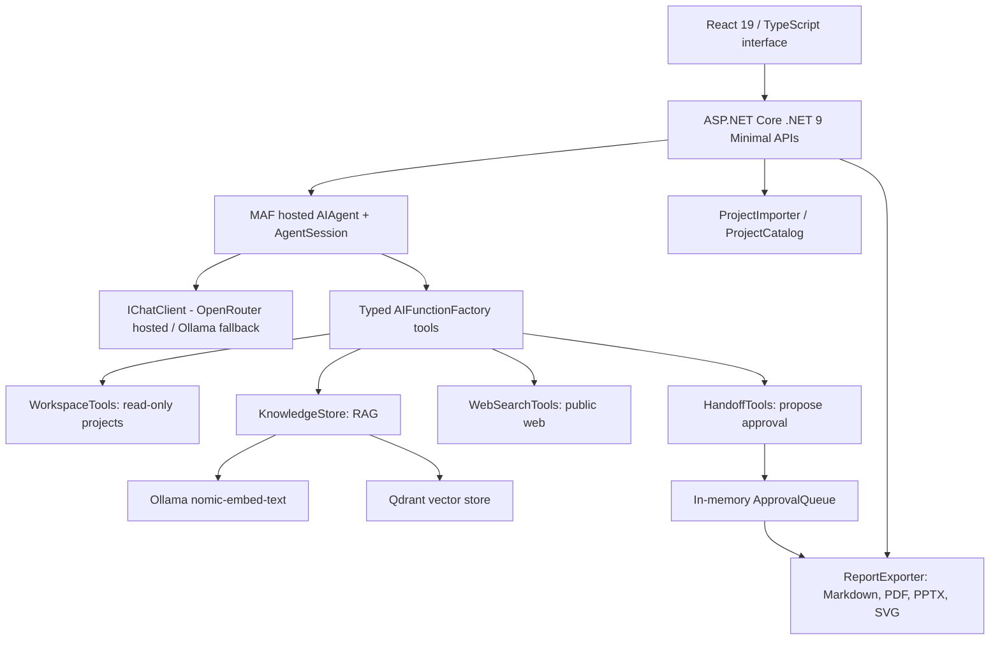

# DeveloperTwin AI v4 — explain every component to a training assessor

## The business problem

Software engineers receive source repositories, ERP requirement documents, issue screenshots, and onboarding tasks. Finding architecture information by hand takes time. The assistant unifies *two core activities*: (1) understand a source project and generate a handoff, and (2) ask questions of uploaded business/technical documents through RAG. Approved handoff export and web search illustrate tool agency and human review.

## End-to-end business process A: source project

1. The engineer chooses a ZIP or an allowed existing folder.
2. `ProjectEndpoints` calls `ProjectImporter` or `ProjectCatalog`.
3. The importer safely extracts only whitelisted source files to `data/workspace/projects`; a link stores a reference to an approved local folder and copies nothing.
4. The UI receives a logical ID such as `projects/project-...` or `linked-...` and obtains an initial folder tree.
5. The engineer clicks Analyze. React posts a natural-language prompt to `/api/agent/ask`.
6. The MAF `AIAgent` decides when to invoke `WorkspaceTools.ListProject` and `WorkspaceTools.ReadFile`. These tools read source **as text only**. Each path is resolved and checked; generated folders and secrets are excluded.
7. The model synthesizes the project purpose, frameworks, folders, critical modules, data flow, environment setup, assumptions, and risks. It should never claim unseen files were checked.
8. The engineer can export the response as PDF/PPTX/Markdown/SVG. `ReportExporter` creates real binary artifacts based on the returned text. For gated exports, the agent proposes a handoff and the human approves it.

**Why this is not an AI-generated ZIP execution tool:** You are analyzing external code, not running foreign code. Uploaded files must never be compiled as part of the assistant. v3 stored source under the web project and hit C# SDK globbing; v4 stores it outside and has compile excludes.

## End-to-end business process B: knowledge base

1. Engineer selects multiple PDFs, business documents, notes or text/code files in React Knowledge Library.
2. `/api/knowledge/batch` validates count, extensions and individual sizes.
3. Every PDF is sent to OpenRouter as a file and processed with its `cloudflare-ai` PDF parser, then analyzed by `Twin:OpenRouterVisionModel`; text/code files use local `TextExtractor`, while image uploads use `VisionTools` with configured OpenRouter or local Ollama vision.
4. `KnowledgeStore` splits text into ~1,100-character overlapping chunks.
5. For each chunk the service calls local Ollama `/api/embed` using the already-installed `nomic-embed-text:latest` model, producing a 768-dimensional vector.
6. The service checks/creates a Qdrant collection and stores the vector with `source`, `text`, `chunk` payload.
7. A question is likewise embedded and used to search closest vectors in Qdrant.
8. The agent receives relevant passages from `SearchKnowledge` and answers using the retrieved context, ideally mentioning source filenames.

**Why Qdrant?** It is a purpose-built vector index. Qdrant does NOT run chat completion or generate documents; embeddings come from Ollama and reasoning comes from the configured MAF agent (OpenRouter or local fallback). The database runs separately in Docker, port 6333 REST, and persists to a Docker named volume. Local Qdrant has no authentication in this demo, so localhost binding is mandatory. See: https://qdrant.tech/documentation/quickstart/

## Architecture in one diagram

## Why each technology is present

| Layer | Specific classes | Job | Why it's in the curriculum |
|---|---|---|---|
| .NET 9 | Program.cs / Endpoints | HTTP host, type-safe API contracts, dependency injection | Move beyond a console prototype; day 6–7 |
| `IChatClient` | Program.cs, HostedFirstChatClient.cs | Standard .NET AI client interface and provider switching | Day 1 |
| Microsoft Agent Framework | `builder.AddAIAgent` | Hosted agent owns instructions and tools | Day 1 / day 6 |
| Typed tools | `AIFunctionFactory.Create(...)` | Register deterministic C# methods callable by the model | Day 2 |
| `AgentSession` | `SessionRegistry` | Retain context within one server instance; semaphore serializes turns | Day 3 |
| Vector RAG | `KnowledgeStore` | Text chunks, embeddings, Qdrant indexing/retrieval | Extended capstone objective |
| Workspace tools | `WorkspaceTools` | Safely list, selectively read, and prepare evidence from connected projects; never run them | Day 2 tools |
| Chat provider selection | `Program.cs`, `HostedFirstChatClient` | Local `qwen3:8b` by default; OpenRouter chat is an explicit provider opt-in. Vision/PDF analysis has a separate OpenRouter path. | Provider abstraction |
| Human review | `HandoffTools`, `ApprovalQueue` | Proposal awaiting explicit approval | Intro to HITL; NOT yet native MAF workflows |
| Web search | `WebSearchTools` | Current public docs from Tavily/Brave, separate from local proprietary files | Tool extension |
| Report output | `ReportExporter` | Deterministic creation of real PDF/PPTX/SVG/MD | Business integration / actions |
| React | `frontend/src/*` | UI state, uploads, loading, cancellation, review/download | Modern full-stack surface |

## Source-by-source reading order

1. **`Program.cs`**: configuration, `IChatClient`, hosted agent registration with `WithAITool` and `WithInMemorySessionStore`; middleware, Minimal API routes.
2. **`Models/TwinSettings.cs`**: typed, documented configuration. Folders under `AllowedProjectRoots` connect directly; outside folders require Approval Center review and an explicit per-folder grant. OpenRouter key comes from environment.
3. **`Agents/HostedFirstChatClient.cs`**: used only when hosted chat is explicitly selected with local fallback enabled; it tries OpenRouter first. Default chat stays local. Do not silently send confidential project material to cloud.
4. **`Agents/SessionRegistry.cs`**: `ConcurrentDictionary` maps `sessionId` to `AgentSession`; `SemaphoreSlim` prevents simultaneous mutations to the same conversation. This is in-memory only.
5. **`Services/WorkspaceTools.cs`**: safe path resolution, symlink blocking, and read-only project inspection. Project analysis sends a bounded tree plus selected real source/configuration contents to the agent; reports must cite those files and identify unsupported conclusions instead of guessing.
6. **`Services/ProjectCatalog.cs`**: controlled absolute folder paths; configured roots connect directly, while explicitly approved outside folders are revalidated and persisted as narrowly scoped linked IDs. No shell commands.
7. **`Services/ProjectImporter.cs`**: ZIP guardrails and extraction to inert data outside compilation.
8. **`Services/KnowledgeStore.cs`**: local embeddings, Qdrant collection and query. The source/payload is the provenance mechanism.
9. **`Services/VisionTools.cs`**: OpenRouter multimodal REST or configured local Ollama vision model; a vision-capable model is required.
10. **`Services/WebSearchTools.cs`**: optional external public web retrieval.
11. **`Services/HandoffTools.cs`**: a proposed report, not immediate external mutation. `ApprovalQueue` retains it temporarily.
12. **`Services/ReportExporter.cs`**: non-generative, deterministic file creation. Different from model reasoning.
13. **`Endpoints`**: DTO input validation, transport-specific business use cases and error results.
14. **`frontend`**: React rendering and file downloads; `api.ts` is the HTTP boundary.

## Microsoft Learn topics mapped to the project

- Getting started: https://learn.microsoft.com/en-us/agent-framework/get-started/
- First agent / `IChatClient`: https://learn.microsoft.com/en-us/agent-framework/get-started/your-first-agent
- Add tools: https://learn.microsoft.com/en-us/agent-framework/get-started/add-tools
- Multi-turn conversations: https://learn.microsoft.com/en-us/agent-framework/get-started/multi-turn
- Agent hosting: https://learn.microsoft.com/en-us/agent-framework/get-started/hosting
- Workflows / orchestration (future extension): https://learn.microsoft.com/en-us/agent-framework/workflows/orchestrations/
- Native human-in-the-loop (future extension): https://learn.microsoft.com/en-us/agent-framework/workflows/human-in-the-loop
- Microsoft Open XML SDK for PPTX: https://learn.microsoft.com/en-us/office/open-xml/open-xml-sdk

Always use current docs for the exact prerelease package APIs. Do not confuse an in-memory approval queue with MAF's resumable workflow approvals (`RequestPort`, `ToolApprovalRequestContent`, checkpoints).

## Questions to prepare for the 15-minute defense

**What is the main difference between a model and an agent?** `IChatClient` supplies completions. An MAF `AIAgent` wraps it with instructions, tool calling and multi-turn sessions.

**Why do you have C# services in addition to agents?** Predictable operations and validation must not depend on the language model producing valid code or binary files. The model chooses what tool to call; the service enforces permissions and executes it.

**How does RAG reduce hallucinations?** It injects relevant source passages into the agent's context. It does not guarantee correctness; the model should cite filenames, and the engineer should verify claims.

**Why is Qdrant optional for chat but required for knowledge?** Direct chat uses a provider's model. Semantic document search uses a vector index; Qdrant is its backing store.

**Why aren't you sending all files to a model?** Context/cost/privacy limits; bounded tools select smaller source files, and RAG selects semantically relevant chunks. Imported folder code is stored locally until the user asks a cloud-backed question.

**Where does approval happen?** `HandoffTools` enqueues an immutable proposal; a human decides via an endpoint; approval produces a local file. For production this must be persisted and authenticated. Native MAF HITL with workflow checkpoints is the next capstone enhancement.

**What are the next production steps?** Identity, authorization, per-user session/namespace isolation, audit logs, stored agent sessions, MAF workflows/checkpoints, SSE tokens/tool activity, observability, unit/integration tests and threat modeling.
