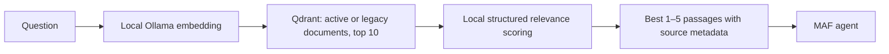

# Reranking and knowledge lifecycle

Implemented scope: the first two phases of the mentor review. The application still uses one hosted MAF agent and the existing `SearchKnowledge` tool. Retrieval logic runs underneath that tool rather than requiring the model to orchestrate another tool.

## Retrieval flow



`KnowledgeStore` owns vectors and payload operations. `KnowledgeRetrievalService` owns candidate selection, reranking, fallback and final selection. `IReranker` allows a dedicated cross-encoder to replace the initial LLM implementation later. `LlmReranker` calls only the configured local Ollama endpoint; `NoOpReranker` preserves vector order.

The default configuration in `src/DigitalTwin.Api/appsettings.json` is:

```json
"KnowledgeMinScore": 0.3,
"KnowledgeCandidateCount": 10,
"Reranking": {
  "Provider": "ollama",
  "Model": "",
  "TimeoutSeconds": 90
}
```

An empty reranking model uses `Twin:ChatModel`, currently `qwen3:8b`. No models are downloaded and no paid provider is introduced. A separate already installed model can be selected with `Twin:Reranking:Model`. Set `Provider` to `none` to compare vector-only retrieval. Candidate count supports 5–10; final result count supports 1–5 through the tool. The reranker uses a bounded context and output budget, with thinking disabled.

Scoring uses Ollama's [structured chat output](https://docs.ollama.com/api/chat). Every candidate must appear exactly once, with a finite score between 0 and 100. Unknown IDs, duplicates, missing scores, malformed responses, provider failures and reranking timeouts trigger vector-order fallback. Caller cancellation propagates. Scores describe relative relevance and are not probabilities.

The knowledge UI shows selected passages and a comparison table for every candidate. The existing `GET /api/knowledge/search?q=...` still returns a hit array. `GET /api/knowledge/search/diagnostics?q=...` additionally returns `candidates`, `hits`, `reranker`, `fallbackUsed` and `warning`. Hits retain the original similarity in `score`, with `vectorRank`, `rerankScore`, final `rank`, point ID, document ID, revision and chunk index.

Aspire/OpenTelemetry receives separate `knowledge.retrieve` and `knowledge.rerank` spans under `knowledge.search`, including candidate counts, reranker identity and fallback status. These spans do not attach queries, document text or filenames. Existing telemetry export settings still apply.

## Document lifecycle and migration

| Action | Stored text/vectors | Normal retrieval |
| --- | --- | --- |
| Active | Retained | Included |
| Deprecate | Retained | Excluded |
| Restore | Retained | Included |
| Delete | Removed | Excluded |

Use the library's **Deprecate**, **Restore** and **Delete** buttons. The status API is `PATCH /api/knowledge/documents/{id}/status` with `{"status":"deprecated"}` or `{"status":"active"}`. Backend code assigns the payload status through Qdrant's [set-payload API](https://api.qdrant.tech/api-reference/points/set-payload); uploaded text cannot assign it.

Filtering happens inside Qdrant before candidate selection. The [filter](https://qdrant.tech/documentation/search/filtering/) accepts `status=active` or an empty/missing status. Existing legacy documents therefore remain searchable without an immediate migration. New points carry `status`, `trustLevel=user-uploaded` and an indexing pipeline identifier. This metadata does not implement the later poisoning-review/guardrail phase.

Re-uploading the same filename replaces that document. Unchanged extracted text with the same indexing pipeline and complete expected point set returns `unchanged=true` without embedding, upserting or resetting chat sessions. Changing the embedding model or chunking version causes re-indexing. Existing points without a pipeline identifier are re-indexed once on their next upload; no bulk re-index runs at startup. Re-uploading a deprecated document preserves its status until explicitly restored.

Ingestion is serialized with lifecycle mutations. All new embeddings are computed before existing content is changed, and successful replacements remove obsolete chunks. Failed batch upserts attempt cleanup of newly introduced points. Qdrant operations remain separate HTTP requests; this is not a distributed transaction or a crash-proof revision publication protocol. A failed cleanup can require re-upload or deletion. Documents above 280,000 extracted characters are rejected rather than silently truncated.

Successful content changes, deprecation, restoration and deletion invalidate cached MAF sessions so later turns start without stale retrieved facts. Visible browser history remains. Durable session persistence and concurrent in-flight run revocation belong to later work. Deprecated vectors are retained until manual deletion; scheduled retention is deferred.

## Local extraction and external processing

Knowledge uploads and chat attachments share `DocumentExtractionService`:

- Searchable PDF: local PdfPig extraction with page references; no external PDF request.
- DOCX: local Open XML extraction of body paragraphs and tables, with a decompressed size limit.
- Text, Markdown, JSON, CSV and supported code formats: local text extraction.
- Scanned/unreadable PDF: fail with an OCR explanation unless the current upload explicitly enables external analysis. With consent, use the existing configured OpenRouter PDF integration.
- Image: use a configured local vision model, or the configured external analyzer when the upload enables external analysis. The text-only chat model is not used for vision.

The new checkbox is off by default. Multipart callers must send `allowExternalAnalysis=true` to allow hosted PDF/image extraction. This choice covers extraction only: if hosted chat is explicitly selected, extracted attachment text can still be included in that hosted conversation. No local OCR model or external API key is installed by this change.

## Verification and demo

From the repository root:

```powershell
dotnet test tests/DigitalTwin.Api.Tests --nologo
npm.cmd --prefix frontend run build
```

The regression suite uses simulated Qdrant/Ollama HTTP contracts and real local PDF/DOCX parsing. The endpoint tests start a temporary HTTP server and exercise the actual knowledge routes. They do not mutate an existing Qdrant collection. The live model evaluation is skipped by default.

Run the opt-in evaluation against your existing Ollama instance:

```powershell
$env:TWIN_RUN_LIVE_RERANK_EVAL = '1'
dotnet test tests/DigitalTwin.Api.Tests --filter 'Category=Live' --logger 'console;verbosity=detailed'
Remove-Item Env:TWIN_RUN_LIVE_RERANK_EVAL
```

`TWIN_EVAL_MODEL` optionally selects another already installed local model. The fixture has ten passages and three known-answer questions. It requires each expected source to rank in the top three and reports vector rank, final rank, score and latency. This small fixture is a regression check, not a broad quality benchmark; it evaluates reranking of fixed candidates independently of embedding recall.

For the complete live demo, start Docker Desktop, then `docker compose up -d`, and run the existing backend and frontend scripts. Upload a small policy, search, compare candidate ranks, upload it again to see **Unchanged**, deprecate it to remove it from search, restore it, then delete it. Upload a searchable PDF with external analysis off to verify local extraction. Use a separate test collection for repeatable experiments.

### Results on November 11, 2026

Backend/test builds and the TypeScript/Vite production build passed. The regression suite passed 36 tests, with the opt-in live test skipped in that default run. The live evaluation was run separately and passed on the already installed `qwen3:8b`:

| Expected passage | Vector rank | Reranked rank | Measured latency |
| --- | --- | --- | --- |
| Project access rules | 2 | 1 | 11.8 s |
| Scanned PDF consent | 8 | 1 | 3.6 s |
| Unchanged embedding reuse | 7 | 1 | 3.6 s |

The initial 45-second cold-model attempt timed out. The configured budget is now 90 seconds and failures still fall back to vector order. The smaller installed `llama3.2:1b` failed the scanned-PDF relevance check, so it was not selected as the default. No new model was downloaded. Live Qdrant ingestion/filtering remains unverified because Docker Desktop's engine was stopped; HTTP contract and lifecycle route tests passed against the fixture. Browser interaction and a live OpenRouter OCR request were not tested.

An isolated API smoke run with `dotnet run --project src/DigitalTwin.Api --no-build --no-restore --no-launch-profile --urls http://127.0.0.1:5097` started successfully. `/api/status` returned the configured local providers, and invalid agent/search requests returned HTTP 400. This verified MAF tool dependency resolution without submitting a chat to a model. The smoke server was stopped afterward.

## Follow-up scope

Dedicated guardrail middleware, poisoning review/quarantine, SQLite conversation/session persistence, explicit long-term memory, full agent-registration extraction and advanced multi-agent/A2A orchestration remain for later phases.
